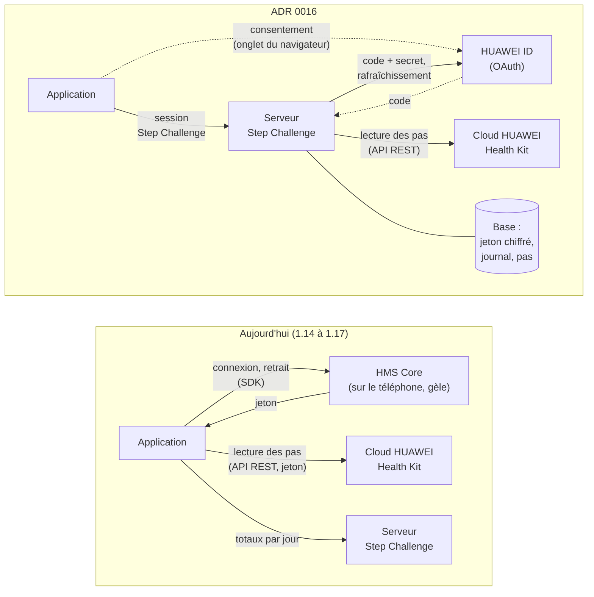
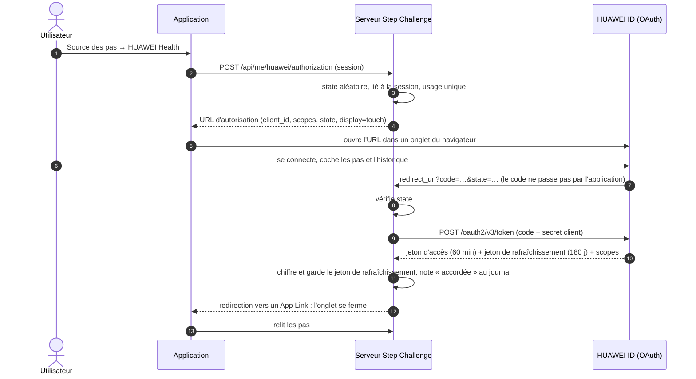
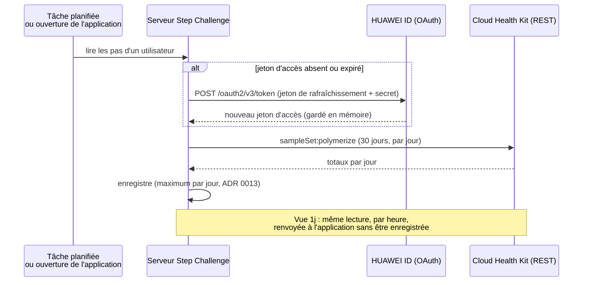
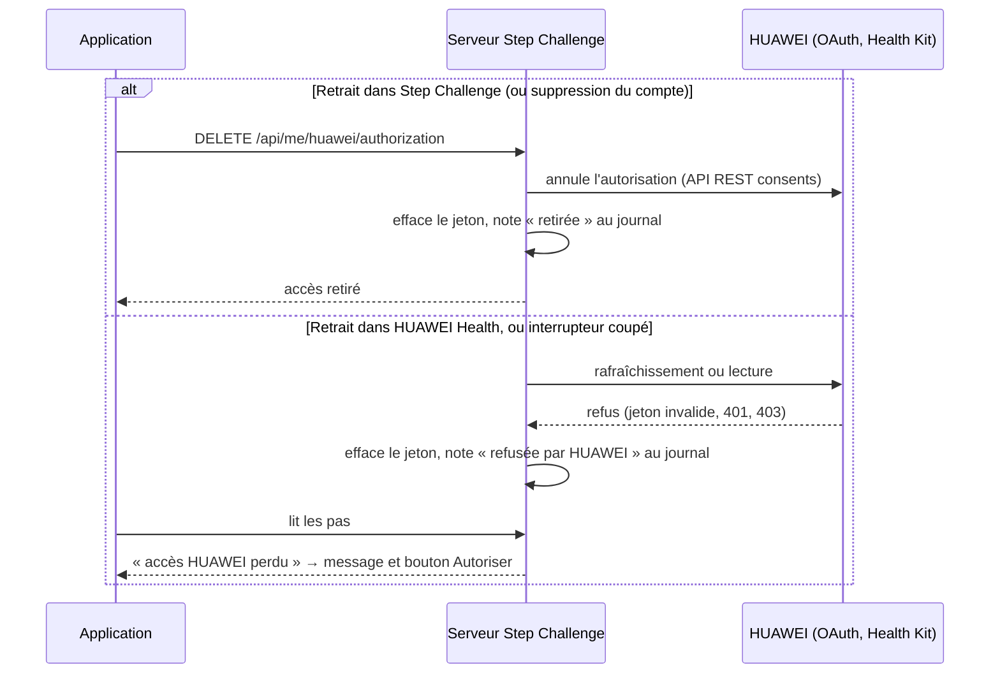

# ADR 0016 — L'autorisation HUAWEI Health par notre serveur (OAuth), sans le SDK HMS

- **Statut** : Proposé
- **Date** : 2026-11-26
- **Décideur** : mauvaisetroupe
- **Lié à** : [ADR 0013 — Source des pas](0013-step-source-choice.md) (en reprend l'option 3, écartée le 2026-11-24), [ADR 0001 — Authentification](0001-authentication.md) (sessions de notre serveur), [vérification Huawei](../reference/huawei-verification.md)

## Contexte

Depuis la 1.14.0 (ADR 0013), l'application se connecte à HUAWEI par le SDK HMS (`HmsHealthAccount.signIn`), puis lit les pas par l'API REST de Health Kit avec le jeton obtenu. Le SDK ne sert qu'à la connexion et au retrait de l'autorisation, mais c'est lui qui pose problème ([intégration Huawei](../explanation/huawei-integration.md), section 16) :

- **Gel de HMS Core** sur un téléphone non Huawei : Android gèle le processus `com.huawei.hwid.container1` ; la connexion ne répond plus, le retrait échoue (50011). La 1.16.0 le contourne (réveil du processus avant chaque appel, délai maximum), sans garantie sur tous les téléphones.
- **Cache périmé** : Step Challenge décochée dans HUAWEI Health, le SDK rend encore des jetons que l'API refuse.
- **HMS Core à installer** depuis AppGallery sur un téléphone d'une autre marque : une étape qui rebute.
- **Profil imposé** : le SDK demande d'office le profil du compte HUAWEI (photo, pseudo), dont Step Challenge n'a pas besoin.
- **Pas d'arrière-plan** : les pas ne sont lus qu'à l'ouverture de l'application.

La vérification de Huawei demande en outre que **le serveur garde une trace** de chaque autorisation accordée ou retirée, ce que l'architecture actuelle ne permet pas.

### Ce que permet Huawei

Huawei propose un parcours OAuth 2.0 par le navigateur (Account Kit, [Obtaining an Access Token](https://developer.huawei.com/consumer/en/doc/HMSCore-Guides/web-get-access-token-0000001050048946), lu le 2026-11-26) :

- autorisation : `https://oauth-login.cloud.huawei.com/oauth2/v3/authorize`, avec `client_id`, `redirect_uri` (identique à celle déclarée), `scope` (qui doit contenir `openid`) et `access_type=offline` pour obtenir un jeton de rafraîchissement ;
- échange du code et rafraîchissement : `https://oauth-login.cloud.huawei.com/oauth2/v3/token`, **avec le secret client** ;
- jeton d'accès valable 60 minutes, jeton de rafraîchissement 180 jours.

Une variante **PKCE**, sans secret, existe, mais elle ne semble pas donner de jeton de rafraîchissement (lu seulement en résumé) : il faudrait repasser par le navigateur toutes les heures.

Health Sync se connecte ainsi (page HUAWEI dans le navigateur, page de son site, retour dans l'application), comme d'autres lecteurs de Health Kit : [RADAR-base](https://github.com/RADAR-base/RADAR-Rest-Source-Auth/pull/358), une [intégration Home Assistant](https://github.com/ucsky/ha-huawei-health-kit), [joyofit](https://github.com/dzulfikar08/joyofit/pull/100). Tous gardent le secret et le jeton de rafraîchissement sur leur serveur.

## Options étudiées

### Option A — Garder le SDK HMS (ADR 0013, avec la parade de la 1.16.0)

- ✅ Rien à faire, déjà publié et testé.
- ❌ La parade au gel n'est vérifiée que sur un Pixel ; le cache périmé et HMS Core à installer restent.
- ❌ Aucune trace côté serveur ; pas d'arrière-plan sans travail supplémentaire (connexion silencieuse dans le travailleur Kotlin, prévue par l'ADR 0013, non faite).

### Option B — OAuth PKCE sur le téléphone, sans serveur

- ✅ Pas de SDK, pas de secret, rien sur notre serveur.
- ❌ Pas de jeton de rafraîchissement (à confirmer) : une page HUAWEI toutes les heures. Écarté si c'est confirmé.

### Option C — OAuth par notre serveur

Le serveur reçoit le code, l'échange avec le secret client, garde le jeton de rafraîchissement et lit les pas.

- ✅ Plus de SDK HMS ni de HMS Core sur le téléphone : plus de gel, plus de cache périmé.
- ✅ La trace des autorisations demandée par Huawei vient du mécanisme lui-même.
- ✅ Lecture en arrière-plan par le serveur, téléphone éteint ou application fermée.
- ✅ Scopes choisis par nous : `openid` sans `profile` (à confirmer).
- ✅ Prépare la connexion HUAWEI ID des téléphones sans services Google (même parcours, même vérification par le serveur).
- ❌ Un jeton HUAWEI par utilisateur sur notre serveur : à chiffrer, à déclarer, à révoquer.
- ❌ Du travail côté serveur (routes, table, tâche planifiée) et une migration des utilisateurs actuels.

## Décision (proposée)

**Option C**, sous réserve des points ouverts 1 à 3.

### Vue d'ensemble

Aujourd'hui (ADR 0013), tout passe par le téléphone ; demain, le serveur parle à HUAWEI et le téléphone ne parle plus qu'au serveur.

HUAWEI Health, sur le téléphone, continue de synchroniser la montre avec le cloud HUAWEI : c'est de là que les deux architectures lisent les pas.

### L'autorisation

- La **redirection va au serveur**, pas à l'application : le code n'arrive jamais sur le téléphone, et le secret reste sur le serveur.
- `state` est émis par le serveur, lié à la session de l'utilisateur, à usage unique et de courte durée : il empêche de rattacher l'autorisation d'un autre compte.
- Scopes : `openid`, `https://www.huawei.com/healthkit/step.read`, `https://www.huawei.com/healthkit/historydata.open.month` ; `display=touch` ; `access_type=offline`.
- Après l'échange, le serveur renvoie vers l'application par un App Link (`sport.architech.lu`), qui ferme l'onglet et relit les pas.

### Ce que le serveur garde

- Par utilisateur : le **jeton de rafraîchissement, chiffré** (clé hors de la base, dans la configuration du serveur), les scopes accordés, les dates d'autorisation et de dernier rafraîchissement. Jamais le profil HUAWEI.
- Un **journal des autorisations** (accordée, retirée par l'utilisateur, refusée par HUAWEI), pour la traçabilité demandée par Huawei. Supprimé avec le compte.
- Le jeton d'accès ne vit qu'en mémoire, une heure au plus.

### La lecture

- **Les totaux par jour** : lus par le serveur, à intervalles réguliers et quand l'application s'ouvre, puis enregistrés comme aujourd'hui (règle du maximum par jour, ADR 0013).
- **Le détail heure par heure** de la vue 1j : lu par le serveur à la demande de l'application et renvoyé sans être enregistré, comme le promet la politique de confidentialité.

### Le retrait

- Bouton « Retirer l'accès » : le serveur annule l'autorisation chez Huawei (API REST `consents`, point ouvert 4), efface le jeton et note le retrait.
- Retrait depuis HUAWEI Health ou interrupteur coupé : le rafraîchissement ou la lecture échoue ; le serveur efface le jeton, note l'événement, et l'application affiche le message de la 1.16.0 avec une nouvelle autorisation.
- Suppression du compte : retrait chez Huawei, puis effacement.

### L'application

- Plus de `@hmscore/react-native-hms-health`, plus de `wakeHuaweiHms`, plus d'`agconnect-services.json` si rien d'autre n'en dépend.
- HUAWEI Health se choisit comme aujourd'hui ; l'autorisation passe par un onglet du navigateur.
- Les utilisateurs déjà autorisés par le SDK refont l'autorisation une fois, à la mise à jour.

## Conséquences

- ✅ Plus de dépendance à HMS Core : l'aide n'a plus à faire installer AppGallery et HMS Core, seulement HUAWEI Health.
- ✅ Pas besoin d'installer HMS Core pour les vidéos de la vérification, ni de dépendre de son gel.
- ✅ Arrière-plan pour les utilisateurs de HUAWEI Health, sans travail sur le téléphone.
- ⚠️ Une donnée de plus sur le serveur : la politique de confidentialité, la section « Sécurité des données » de Google Play et la check-list de Huawei sont à mettre à jour avant la version.
- ⚠️ Le secret client HUAWEI devient un secret de production, à ranger avec les autres ([Comptes, consoles et secrets](../reference/accounts-and-secrets.md)).
- ⚠️ Une adresse de redirection publique sur le serveur, à ajouter à la [surface d'exposition](../reference/exposure.md).

## Points ouverts

1. **Le secret client** : celui de l'application Android dans AppGallery Connect est-il accepté pour les scopes Health Kit dans ce parcours, ou faut-il une application Web, avec une nouvelle demande Health Kit et une nouvelle vérification ? À demander à Huawei ou à essayer.
2. **L'adresse de redirection** : où la déclarer, HTTPS obligatoire, domaine de l'API ou `sport.architech.lu`.
3. **Le parcours PKCE** : confirmer qu'il ne donne pas de jeton de rafraîchissement. S'il en donne un sans secret, l'option B redevient possible et doit être comparée.
4. **L'API REST de retrait** (`DELETE /healthkit/v2/consents/{appId}`, vue dans du code tiers) : à trouver dans la documentation officielle, avec ses paramètres.
5. **`openid` sans `profile`** : vérifier que Huawei l'accepte et que l'écran n'affiche plus la photo et le pseudo.
6. **Limites de l'API REST** côté serveur (nombre d'appels, fréquence de lecture raisonnable).
7. **La connexion HUAWEI ID** des téléphones sans services Google : à décider dans un ADR à part, en réutilisant ce parcours.
