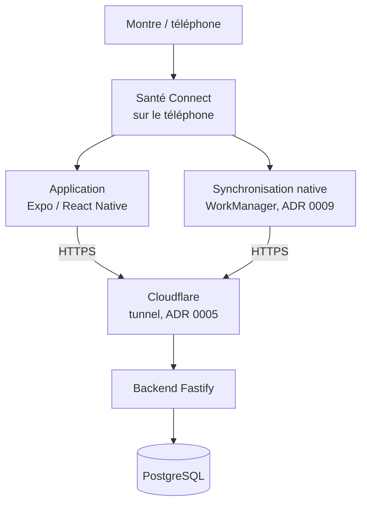
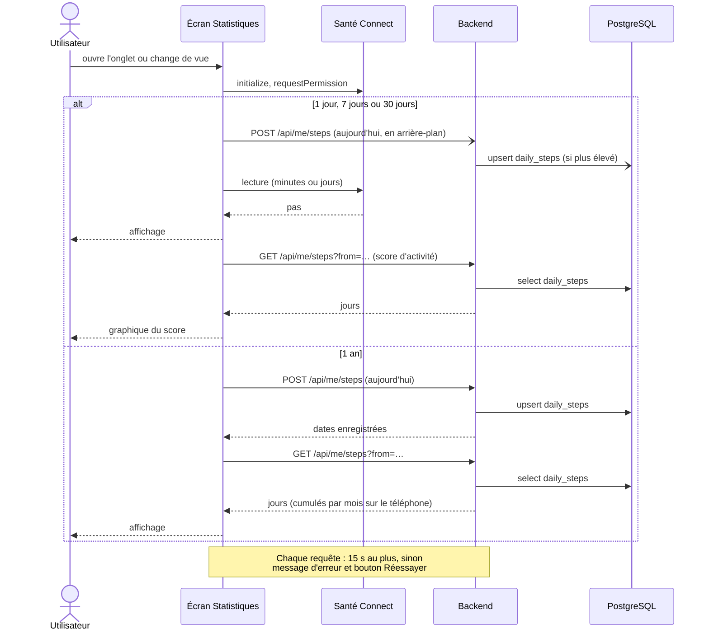
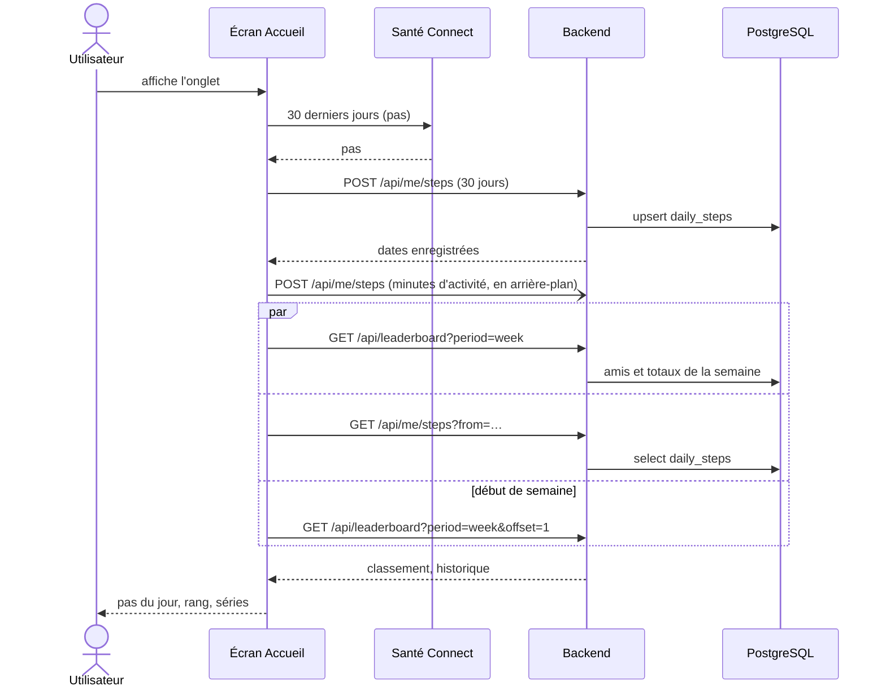
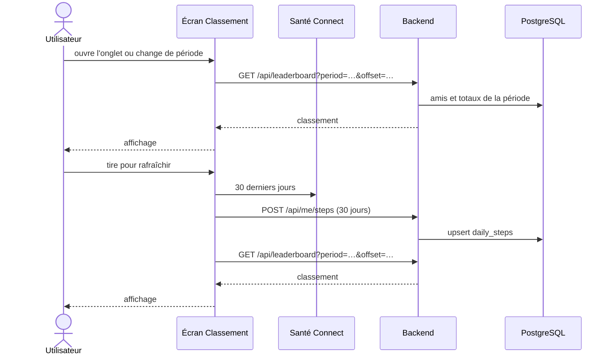

# Architecture

Document de référence sur le fonctionnement d'ensemble de Step Challenge. Les décisions elles-mêmes sont dans les ADR (`docs/adr/`) ; ce document décrit ce qui en résulte dans le code. Il est commencé, à compléter au fil de l'eau.

**Dernière mise à jour : 2026-10-29**

## Vue d'ensemble

- **Santé Connect** est la référence pour les jours récents : l'application le lit directement, sans réseau. Sur un téléphone sans Santé Connect (Huawei), le podomètre du téléphone le remplace pour aujourd'hui seulement, quand le build l'a (voir `huawei/README.md`).
- **La base** garde un total par jour et par utilisateur (`daily_steps`). Elle sert au classement entre amis, à l'historique long (vue 1 an, séries de l'accueil) et à tout ce qui n'a pas Santé Connect (web, Huawei).
- L'envoi des pas est **idempotent** : le backend ne garde un jour que si le total reçu est plus élevé que celui qu'il a (ou si les minutes d'activité changent). Envoyer trop souvent ne coûte qu'une requête.

## Accès au réseau

### Règles communes

Tous les appels de l'application passent par `apiFetch` (`apps/mobile/src/api/client.ts`) :

- jeton de session en `Authorization: Bearer` ; chaque requête authentifiée lit et prolonge la session dans la table `sessions` ;
- **délai maximal de 15 s**, réponse comprise (`REQUEST_TIMEOUT_MS`), au-delà duquel la requête est annulée et une `TimeoutError` est levée (« Le serveur ne répond pas… »). Sans ce délai, React Native n'en a aucun sur Android : une requête partie sur une connexion morte (passage du Wi-Fi aux données mobiles, mauvais réseau) ne se terminait jamais, et l'écran restait sur son indicateur de chargement jusqu'à ce qu'on tue l'application ;
- un 401 renvoie à l'écran de connexion.

La synchronisation native (`StepSyncWorker.kt`) n'utilise pas `apiFetch` : elle a ses propres délais (30 s de connexion et de lecture).

Le démarrage de l'application ne fait **aucune** requête : `src/app/index.tsx` regarde seulement si un jeton est enregistré sur le téléphone.

### Tableau des appels

| Moment | Requêtes | Bloque l'affichage ? |
|---|---|---|
| Accueil, à chaque affichage de l'onglet et en tirant pour rafraîchir | `POST /api/me/steps` (30 jours de Santé Connect), puis en parallèle `GET /api/leaderboard?period=week`, `GET /api/me/steps?from=…` (séries) et, en début de semaine, `GET /api/leaderboard?period=week&offset=1`. En arrière-plan : `POST /api/me/steps` avec les minutes d'activité | Oui : au premier affichage, l'écran attend la fin de l'envoi et des lectures. Ensuite, l'ancien contenu reste affiché pendant le rechargement. Un seul chargement à la fois |
| Statistiques, vues 1 jour (aujourd'hui), 7 jours, 30 jours, avec Santé Connect | `POST /api/me/steps` (aujourd'hui), **en arrière-plan** | Non : ces vues lisent Santé Connect |
| Statistiques, 1 jour passé | Aucune | Non |
| Statistiques, vue 1 an | `POST /api/me/steps` (aujourd'hui), puis `GET /api/me/steps?from=…` | Oui : l'envoi d'abord, pour que le mois en cours compte aujourd'hui. Un échec de l'envoi n'empêche pas l'affichage |
| Statistiques, graphique du score d'activité (7 j, 30 j, 1 an) | `GET /api/me/steps?from=…` | Non : chargé après la vue, au mieux |
| Statistiques sans Santé Connect (web, Huawei) | Huawei : `POST /api/me/steps` (podomètre), puis `GET /api/me/steps?from=…` pour 7 j, 30 j et 1 an | Oui |
| Classement, à l'ouverture et au changement de période | `GET /api/leaderboard?period=…&offset=…` | Oui |
| Classement, tirer pour rafraîchir | `POST /api/me/steps` (30 jours), puis `GET /api/leaderboard` | Oui. Un échec de l'envoi n'empêche pas l'affichage |
| Paramètres → Synchronisation → « Synchroniser maintenant » | `POST /api/me/steps` (30 jours avec minutes d'activité) | Oui |
| Paramètres → Compte | `GET /api/me`, et `PATCH` / `DELETE /api/me` sur action | Oui |
| Amis, invitations, blocages, signalements | `/api/friends`, `/api/invitations`, `/api/blocks`, `/api/reports` | Sur action |
| Arrière-plan, application fermée (ADR 0009) | `POST /api/me/steps` par le worker natif, environ toutes les 6 h | — |

`POST /api/me/steps` envoie au plus `MAX_DAYS_PER_REQUEST` (31) jours par requête (`src/api/steps.ts`) : les 30 jours tiennent en une requête.

## Séquences

### Statistiques

### Accueil

### Classement

## Points ouverts

- **Pas de cache côté application** : sans réseau, la vue 1 an, le classement, les séries de l'accueil et toutes les vues sans Santé Connect n'ont rien à montrer. Piste : garder le dernier résultat de chaque lecture (AsyncStorage) et l'afficher avec sa date en attendant la réponse.
- **L'accueil attend l'envoi des 30 jours** avant de lire le classement, pour qu'il compte aujourd'hui. C'est voulu, mais une connexion lente le retarde (15 s au plus).
- Les envois se recoupent : l'accueil, les statistiques, le classement et le worker envoient les mêmes jours. C'est sans risque (idempotent), mais cela fait des requêtes en plus.
