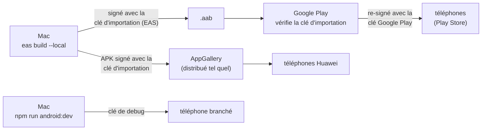

# Les clés de signature Android

Pourquoi l'application a des clés, pourquoi trois, et pourquoi Google Cloud, le site et Huawei veulent leurs
empreintes. Les valeurs et les commandes sont dans la [référence](../reference/android-signing.md).

## Ce que prouve une signature

Tout APK installé sur Android est **signé** : une clé privée signe le contenu, et le certificat qui va avec (la partie
publique) est joint à l'application. Android s'en sert pour une chose essentielle : **une mise à jour n'est acceptée
que si elle est signée par le même certificat** que l'application installée. Sans ça, n'importe qui pourrait publier
un « Step Challenge » qui remplacerait le vrai et lirait ses données.

Le certificat ne dit donc pas « c'est sûr », mais « c'est le même auteur que la dernière fois ». Il n'est pas émis par
une autorité, et il vaut pour toute la vie de l'application.

## Une clé par usage

- **La clé Google Play** (*app signing key*) signe l'application installée depuis le Play Store. Google l'a créée et
  la garde : personne ne peut la perdre ni la voler. C'est **Play App Signing**, obligatoire pour un `.aab`.
- **La clé d'importation** (*upload key*) prouve à Google que l'`.aab` envoyé vient bien de l'auteur ; Google la
  retire et signe avec la sienne. Perdue ou volée, Google la remplace sur demande. Elle est stockée chez **EAS**
  (credentials), pas sur le Mac. Particularité : l'**APK d'AppGallery** est signé avec elle et distribué tel quel, sans
  re-signature : pour les téléphones Huawei, c'est elle la clé de l'application.
- **La clé de debug** signe les builds de développement. C'est celle du modèle React Native, la même dans tous les
  projets, avec un mot de passe public : elle ne prouve rien, et doit rester réservée au package de développement
  (`.dev`).

Une application du Play Store (clé Google Play), un APK d'AppGallery (clé d'importation) et un build de développement
(clé de debug) sont donc, pour Android, **trois auteurs différents** : l'un ne remplace pas l'autre sans
désinstaller. La variante de développement a d'ailleurs son propre package, pour s'installer à côté.

## Pourquoi trois services veulent les empreintes

Une **empreinte** (SHA-1, SHA-256) est un résumé court du certificat : publique, elle l'identifie sans rien révéler de
la clé privée. Chaque service qui doit reconnaître « la vraie application » la demande :

- **Connexion Google** : Google ne donne un jeton qu'à une application dont le package et le certificat correspondent
  à un client OAuth Android du projet `step-challenge`. Un client par clé.
- **App Links** : Android n'ouvre les liens `https://step.architech.lu/i/…` directement dans l'application que si le
  site publie son empreinte dans `/.well-known/assetlinks.json`. Sans ça, un lien d'invitation ouvrirait le navigateur.
- **Huawei** : HMS Core vérifie l'application avant de lui donner accès à Health Kit.

Le cas le plus fréquent : tout marche en local, rien avec l'application du Store. C'est presque toujours la clé
Google Play, chez Google et jamais utilisée en local, qui n'a pas été déclarée.

## Ce qu'il faut retenir

| Clé | Secret ? | La perdre |
|---|---|---|
| Google Play | Chez Google | Impossible |
| Importation | Oui (EAS) | Remplaçable par Google ; déclarer la nouvelle empreinte partout, et AppGallery devra accepter une nouvelle clé |
| Debug | Non (publique) | Sans objet |
