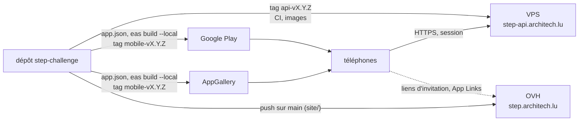

# Versions et livraisons

Step Challenge arrive aux utilisateurs par **quatre chemins**, chacun avec son rythme.

| Partie | Numéro | Construit par | Arrive chez l'utilisateur | Retour en arrière |
|---|---|---|---|---|
| API (`backend/`) | Tag `api-vX.Y.Z` | La CI | Au déploiement (`deploy-app`) | `deploy-app` de la version précédente |
| Application, Google Play | `version` de `app.json`, tag `mobile-vX.Y.Z` | Le Mac (EAS en local) | Après l'examen de Google, puis la mise à jour du Store | Impossible : une nouvelle version |
| Application, AppGallery | Même version et même tag | Le Mac (profil `appgallery`) | Après l'examen de Huawei (3 à 5 jours) | Impossible : une nouvelle version |
| Site (`site/`) | Aucun | La CI (`deploy-site.yml`) | Au push sur `main` | `git revert`, push |

Les numéros de l'API et de l'application sont **indépendants** : une version de l'API peut ne rien changer à
l'application, et l'inverse.

## L'ordre d'une mise en production

Quand une version touche plusieurs parties :

1. **API** : tag, puis déploiement ([Publier une version de l'API](../how-to/release-the-api.md)).
2. **Site** : pages légales et aide à jour (politique de confidentialité si la collecte change), **avant** l'envoi aux
   boutiques : les examinateurs la lisent.
3. **Application** : build, puis envoi à Google Play et à AppGallery, avec les déclarations des consoles mises à jour
   si les autorisations ou les données changent.
4. **`STATUS.md`** : version, date, ce qui reste à vérifier.

## Pourquoi l'API reste compatible

Une seule API sert, au même moment, toutes les versions de l'application encore installées, sur les deux boutiques,
et le travailleur Kotlin qui synchronise en arrière-plan (ADR 0009). Certaines ont plusieurs mois. D'où les règles :
ajouter, ne jamais retirer ni renommer un champ ou une route tant qu'une version qui s'en sert peut tourner ;
l'adresse `https://step-api.architech.lu` ne change jamais (elle est dans l'application).

## Pourquoi des notes écrites depuis git

Les notes de l'API sont faites pour l'**exploitant** : ce qu'il doit faire avant de déployer, et s'il peut revenir en
arrière. Écrites à la main, elles s'oubliaient ou divergeaient du code. Tirées de git, elles reposent sur une seule
discipline : marquer `!` le commit qui demande une action, et y écrire laquelle. Le même script sert à CountRep.

## Pourquoi taguer l'application

Les builds se font sur le Mac, pas dans la CI : sans tag, rien ne relie une version des boutiques à un commit. Le tag
`mobile-vX.Y.Z`, posé après l'envoi, et `requireCommit` (pas de build avec des modifications non commitées) font que
le code d'une version se retrouve toujours exactement.

## Pourquoi deux rôles : mainteneur et exploitant

Ce dépôt **livre** des images versionnées et leur mode d'emploi ([exploitation](../exploitation.md)) ; le dépôt
`vps-infra` les **exploite** (ADR 0011). La même personne tient les deux, mais la frontière permet de changer
d'hébergement sans toucher au code.
