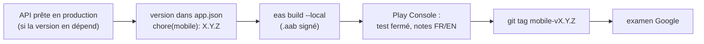

# Publier l'application sur Google Play

L'application (`apps/mobile`, package `lu.architech.stepchallenge`) est construite **en local** avec EAS, puis envoyée
à la main dans la Play Console. Sa version est celle de `apps/mobile/app.json`, indépendante des tags `api-v*`
([pourquoi](../explanation/versions-and-releases.md)).



EAS (cloud) ne sert qu'à stocker les credentials Android (keystore, alias, mots de passe), les variables
d'environnement par environnement et le `versionCode` : **les builds se font en local**. Credentials :
`npx eas-cli credentials` ; variables : `npx eas-cli env:list --environment production`.

## 1. Vérifier l'ordre

Si la version utilise une route ou un champ nouveau de l'API, [publier l'API](release-the-api.md) et la déployer
**d'abord**. Si elle change les autorisations ou les données collectées, mettre à jour **avant l'envoi** le
formulaire « Sécurité des données » et la déclaration « Applis de santé » de la Play Console, et la politique de
confidentialité du site ([Mettre à jour le site](update-the-public-site.md)) : les examinateurs les lisent.

## 2. Monter la version

Monter `version` dans `apps/mobile/app.json` (affichée aux utilisateurs, et dans les notes de version) et commiter :

```bash
git commit -am "chore(mobile): 1.12.0"
```

Le `versionCode` n'est pas à toucher : EAS l'incrémente à chaque build de production (`appVersionSource: remote`,
`autoIncrement` dans `eas.json`).

**Tout commiter** : EAS refuse de construire avec des modifications non commitées dans le dépôt, `backend/` et `site/`
compris (`requireCommit` dans `eas.json`). Le build correspond ainsi exactement à un commit, celui que marquera le tag.

## 3. Construire

Avant : une dizaine de Go libres (`df -h`) : le build compile dans `$TMPDIR`. Les anciennes versions de
`~/.gradle/caches` et `~/.gradle/wrapper/dists`, le cache npm et le cache de build Docker se suppriment sans risque.

```bash
cd apps/mobile
npx eas-cli build --platform android --profile production --local
```

Le build produit un `.aab` signé avec la clé d'importation ; Google le re-signe avec sa propre clé
([Les clés de signature](../explanation/android-signing.md)).

**R8** : une nouvelle bibliothèque native peut casser en production seulement (code obscurci). Tester en release avant
d'envoyer (`APP_VARIANT=development` puis `./gradlew :app:assembleRelease`), et ajouter les règles manquantes dans
`extraProguardRules` (`app.json`), d'après `android/app/build/outputs/mapping/release/missing_rules.txt`.

## 4. Envoyer dans la Play Console

Play Console › Step Challenge › Tester et publier › **Test fermé** › Créer une release :

1. Importer le `.aab`.
2. Notes de version en français et en anglais :

   ```
   <fr-FR>
   …
   </fr-FR>
   <en-US>
   …
   </en-US>
   ```

3. Enregistrer, puis **Envoyer pour examen** (Vue d'ensemble de la publication).

## 5. Taguer

Une fois la version envoyée (et l'APK AppGallery, s'il est construit depuis le même commit :
[Publier sur AppGallery](publish-on-appgallery.md)) :

```bash
git tag mobile-v1.12.0
git push origin mobile-v1.12.0
```

Le tag `mobile-v*` ne déclenche rien dans la CI (seuls les `api-v*` publient des images). Il sert à retrouver le code
d'une version : `git show mobile-v1.12.0`, ou `git diff mobile-v1.12.0..HEAD -- apps/mobile` pour ce qui a changé
depuis. Les versions jusqu'à la 1.11.0 n'ont pas de tag.

## 6. Après l'examen

Installer la mise à jour depuis le Play Store et vérifier connexion, synchronisation, classement. Mettre à jour la
ligne « Application » de [`STATUS.md`](../STATUS.md) (version, versionCode, date).

Pendant l'examen, le robot de test de Google crée des comptes sans pas (voir les pièges de `STATUS.md`) : ne jamais
les rendre amis de tout le monde.
