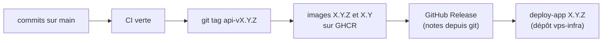

# Publier une version de l'API

Une version de l'API, c'est l'image `step-challenge-api` et l'image `step-challenge-migrations`, toujours au même
numéro ([ADR 0011](../adr/0011-backend-hosting.md)). Elle se publie par un tag git `api-vX.Y.Z` ; l'application mobile
a sa propre version ([pourquoi](../explanation/versions-and-releases.md)).



Chaque push sur `main` publie déjà les deux images sous `sha-<commit>`, une fois les tests passés : de quoi essayer un
commit précis.

## 1. Préparer

- **Compatibilité** : l'API doit accepter **toutes les versions de l'application encore installées** (et le travailleur
  Kotlin de synchronisation, ADR 0009), qui ne changent qu'avec les boutiques. Ne jamais retirer ni renommer un champ
  ou une route encore utilisés.
- **Action de l'exploitant** (variable ajoutée ou retirée, version de PostgreSQL, migration lourde ou sans retour en
  arrière) : le commit qui la provoque touche `backend/`, est marqué `!` et dit quoi faire, par exemple :

  ```
  feat(backend)!: add WEEK_START

  BREAKING CHANGE: set WEEK_START in the .env of the host (optional, default monday)
  ```

  Ces commits remontent dans « À lire avant de déployer » des notes de version. Une variable se décrit aussi dans
  [`exploitation.md`](../exploitation.md), dans le même commit.
- **Migration** : jamais de modification d'une migration publiée ([`backend/migrations/`](../../backend/migrations/README.md)).
  Le script des notes de version échoue sinon.

## 2. Choisir le numéro

Version précédente : `git describe --tags --abbrev=0 --match 'api-v*'`.

| Changement | Exemple depuis `1.2.1` |
|---|---|
| Correctif seulement | `1.2.2` |
| Ajout compatible (route, champ, migration compatible) | `1.3.0` |
| Action de l'exploitant ou migration sans retour en arrière | `2.0.0` |

Un tag de préversion (`api-v1.3.0-rc.1`) ne publie que les images `sha-…`, sans version ni release.

## 3. Relire les notes avant le tag

Les notes sont écrites par `.github/release-notes.sh`, depuis git : commits du backend marqués `!`, migrations
ajoutées, commits du backend depuis la version précédente. Les voir avant de publier :

```bash
git tag api-v9.9.9 && .github/release-notes.sh api-v9.9.9; git tag -d api-v9.9.9
```

Si « À lire avant de déployer » est incomplet (un commit `!` oublié), le dire dans un commit vide marqué `!` :
`git commit --allow-empty -m "chore(backend)!: …" -m "BREAKING CHANGE: …"`.

## 4. Publier

```bash
git switch main && git pull
git push                                   # si des commits locaux restent
```

Attendre la CI verte sur ce commit (onglet Actions, ou `gh run watch`). Puis :

```bash
git tag api-v1.3.0
git push origin api-v1.3.0
```

La CI publie les deux images sous `1.3.0` et `1.3`, puis la GitHub Release « API 1.3.0 » avec les notes. Vérifier :

```bash
gh run watch
gh release view api-v1.3.0
docker manifest inspect ghcr.io/mauvaisetroupe/step-challenge-api:1.3.0 > /dev/null && echo ok
```

**Tag posé par erreur, avant la fin de la CI** : `git push origin :refs/tags/api-v1.3.0 && git tag -d api-v1.3.0`,
supprimer la release si elle existe (`gh release delete api-v1.3.0`), puis recommencer. Si l'image a déjà été
déployée, prendre plutôt le numéro suivant.

## 5. Déployer en production

L'API tourne sur le VPS depuis le 2026-10-27, exploitée depuis le dépôt **`vps-infra`** (`../vps-infra`), qui a sa
propre documentation (`apps/step/README.md`, `docs/how-to/deploy-a-version.md`). En résumé, depuis le Mac :

```bash
ssh -t vps-ovh sudo -iu step grep VERSION app/.env       # la version en service
ssh -t vps-ovh sudo -iu step deploy-app 1.3.0
```

`deploy-app` télécharge les images, arrête l'API, sauvegarde la base, applique les migrations, redémarre et attend la
santé ; en cas d'échec, il relance la version précédente. Si les notes demandent une action (variable…), la faire
**avant**, dans `vps-infra/apps/step/` puis le `.env` du host.

## 6. Vérifier

```bash
curl -s https://step-api.architech.lu/api/health          # {"status":"ok"}
```

Puis dans l'application, sur le téléphone : connexion, synchronisation, classement. Mettre à jour la ligne « API » de
[`STATUS.md`](../STATUS.md).

**Revenir en arrière** : `deploy-app <version précédente>`, ou restauration si la migration n'est pas compatible
([exploitation, Revenir en arrière](../exploitation.md#revenir-en-arrière), et le guide de `vps-infra`).
